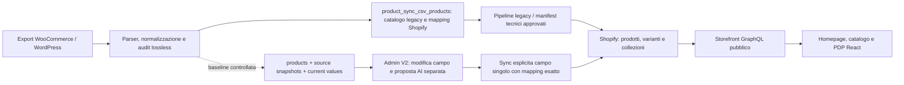

# Audit catalogo e allineamento collezioni — 30 ottobre 2026

**Esito: audit statico completato; verifica LIVE Storefront completata; riconciliazione integrale dei 903 e degli 82 DA COMPLETARE quando saranno disponibili dati e autorizzazioni.** Nessuna scrittura live, importazione, riassegnazione, AI, checkout o modifica a permessi/configurazioni.

Baseline remota verificata tramite API GitHub e fetch: PR #39 `aa7e6aeb9aa0eafc01f655976f342733562bb824`; UI PR #41 `d4029b56da33cc0aeecfd45bac43c82d79b67b08`, base #39. Worktree isolato `/private/tmp/online-garden-catalog-autonomy-audit`, branch `codex/catalog-autonomy-audit` derivato da #41. PR e worktree precedenti preservati; pubblicazione del solo branch documentale separato, come richiesto nel successivo aggiornamento dell’utente.

## 1. Fonti e grado di evidenza

| Fonte | Cosa prova | Cosa non prova |
| --- | --- | --- |
| [Allineamento del 10 ottobre](fase3b/shopify-collections-alignment.md) | Risultato storico: 903 famiglie, 821 assegnate, 82 NEEDS_REVIEW; regole per categorie WordPress esatte | Stato attuale degli stessi ID |
| [Tassonomia frontend](../src/config/categories.ts), allowlist in [proxy](../supabase/functions/shopify-admin-proxy/index.ts) | 23 handle canonici nel proxy; oggi 18 handle reali nel menu + `all` virtuale | Approvazione delle singole membership o tassonomia Supabase live |
| [CSV e riepilogo di questo audit](catalog-audit-evidence/2026-10-30/README.md) | Product/Variant GID, SKU e collezioni esposti al token pubblico nel contesto corrente | Bozze, archiviati, pubblicazioni di tutti i canali, appartenenza alla coorte 903 |
| Codice e migration del branch | Rotte, contratti, controlli e flussi disponibili nel sorgente | Versione effettivamente deployata, flag server e ruoli di Marco |
| Connettore Supabase | Progetto atteso `iekwvvihjwghosqdxrdi` identificato dal repository; richiesta get_project negata | Qualunque conteggio/stato attuale delle sue tabelle |

Nessun connettore Shopify Admin è disponibile tra gli strumenti; nessuna tab autorizzata Shopify Admin è stata rilevata nell’inventario browser. Il connettore Supabase disponibile non elenca il progetto atteso e ne nega l’accesso diretto. Non sono state interrogate altre basi dati, chiamate Edge Function o cercati bypass/credenziali alternative. L’utente ha confermato di non avere ora una connessione Shopify Admin read-only né l’export storico. Si completa quindi l’audit disponibile; la riconciliazione integrale è un’attività successiva con prerequisiti espliciti, non un blocco generale delle altre attività del progetto.

La lettura pubblica è stata eseguita il **30 ottobre, 15:44:19–15:44:37 Europe/Rome**, tramite 74 query GraphQL, oltre a un preflight iniziale. Token letto in memoria dalla configurazione pubblica già autorizzata, mai stampato o copiato. Nessuna mutation. Versione richiesta `2025-07`, versione restituita nell’header Shopify **`2026-01`**: fall-forward effettivo osservato, da gestire con una successiva verifica di compatibilità, non modificato qui.

## 2. Catena WordPress → Supabase → Shopify → Storefront

Il diagramma distingue percorsi nel codice e baseline documentate: non certifica che ogni freccia sia oggi automatica o deployata.

1. **Sorgente:** [audit WordPress](wordpress-import-audit.md): otto CSV, 2.637 righe, 2.560 SKU unici nello snapshot del 22 settembre. Sono righe simple/parent/variation, non 903 famiglie. [Resolver lossless](../src/catalog/lossless/sourceResolver.ts) e script golden conservano provenienza/conflitti; gli input originali sono privati e non sostituibili con fixture. Non è un importer automatico per prodotti Shopify nuovi.
2. **Legacy Supabase:** [product-catalog-repo](../supabase/functions/_shared/product-catalog-repo.ts) aggiorna `product_sync_csv_products` per SKU, con merge non distruttivo dei campi presenti. `start-product-sync` crea job e `process-product-sync` esegue pipeline: anche un preteso “controllo” tramite questi endpoint può avere effetti, quindi non sono stati invocati.
3. **Modello canonico:** `products.id` UUID, `sku`/`sku_norm` univoco, `entity_type`, `parent_product_id`; snapshot immutabili, valori correnti e storia separati. Le migration proteggono l’identità. Origine `manuale` è già prevista. Le categorie canoniche hanno tabelle dedicate `product_categories`, `product_category_source_map`, `product_category_assignments`, `product_category_shopify_map`. Lo stato popolato di queste tabelle è oggi non verificato.
4. **Outbound Shopify:** sync legacy può aggiornare il mapping nella tabella legacy; `shopify-create-batch` crea famiglie in DRAFT da manifest privati e registra Product/Variant GID nel ledger. La pubblicazione è separata in `shopify-publication-batch`, con approvazione/digest/gate. Non sono flussi self-service Admin V2.
5. **Mapping usato oggi da Admin V2:** `getExactShopifyProductMapping` in [admin-v2-queries](../supabase/functions/_shared/admin-v2-queries.ts) cerca **SKU esatto in `product_sync_csv_products`**. Un GID presente solo nel ledger non basta. [Backfill tecnico](../scripts/admin-shopify-id-backfill.sql) riconcilia mapping da evidenze verificate e relazioni parent canoniche: esiste ma non è stato eseguito in questo audit; non crea un importer generale Shopify → Supabase.
6. **Storefront:** [shopify.ts](../src/lib/shopify.ts) legge direttamente Shopify. Non legge la classificazione Supabase come fonte del catalogo pubblico. `/collections/all` legge tutti i prodotti esposti, sottraendo i due ID test configurati. Le membership appartengono al Product GID; le varianti seguono il prodotto.
7. **Inbound mancante nel percorso analizzato:** non è stato trovato un consumer webhook prodotti o un job periodico che registri automaticamente in `products`/current values i nuovi prodotti creati direttamente in Shopify. La creazione AI legacy non registra né identità canonica né mapping. Occorre riconciliazione esplicita; non si può promettere che “creato in Shopify” significhi “presente in Admin V2”.

## 3. Storico: conteggi da preservare come storico

| Metrica | Evidenza storica | Stato live della stessa coorte |
| --- | --- | --- |
| Famiglie create 3B.2 | 903; report scale-out: 930 varianti, inizialmente DRAFT | Non riconciliabile senza elenco Product GID/parent SKU approvato |
| Famiglie assegnate 10 ottobre | 821: 732 mono-categoria raw, 89 multi-categoria raw mappabile | Correttezza attuale non attestata |
| NEEDS_REVIEW | 82: 81 categorie “Piante da Interno”, un caso con “Piante Palustri” | Aperte/risolte: **non determinabile** senza elenco e decisioni |
| Varianti coperte via parent nell’allineamento | 847 | Metrica di quel report, distinta dalle 930 varianti create |
| Collezioni canoniche | 23, già esistenti nel report | Tutte e 23 oggi risolvibili dal token pubblico |

Le 89 famiglie multi-categoria raw non sono confrontabili direttamente con i prodotti multi-collezione: la regola “Arbusti → arbusti + piante-da-esterno” crea due membership anche per una categoria sorgente singola. Gli **82 bulbi** citati nel dry-run F4.7 sono un altro insieme, non gli 82 NEEDS_REVIEW del 10 ottobre. Il report F4 del 17 agosto registrava zero assegnazioni interne: non prova che siano ancora zero dopo il successivo allineamento Shopify.

## 4. LIVE: perimetro pubblico effettivamente enumerato

Tutte le connection prodotti/varianti/collezioni sono state paginate fino a `hasNextPage=false`. Sono stati confrontati entrambi i versi delle membership: **1.961 coppie identiche**, zero discrepanze tra `product.collections` e `collection.products`. Non è uno snapshot transazionale del database e non comprende risorse non esposte al token.

| Metrica LIVE | Conteggio | Interpretazione |
| --- | ---: | --- |
| Product GID distinti esposti dall’API | 1.348 | Record Shopify pubblici; non famiglie canoniche confermate |
| Variant GID distinti esposti | 1.376 | Comprese le varianti dei due prodotti test |
| Product GID visibili dopo filtro applicativo | 1.346 | Solo esclusione dei due ID test già nel codice |
| Varianti corrispondenti | 1.374 | SKU tutti presenti e univoci anche dopo trim/lowercase |
| Con almeno una collection canonica pubblica | 982 | Membership osservata, **non “assegnazione corretta” certificata** |
| Senza alcuna collection esposta | 191 | Non equivale a nessuna collection Admin/non pubblicata |
| Senza una delle 23 collection canoniche esposte | 364 | Include i 191 sopra + 173 con sole collezioni non canoniche |
| Con più collezioni pubbliche | 697 | Sovrapposizione lecita possibile, nessuna rimozione proposta automaticamente |
| Con più collezioni canoniche pubbliche | 562 | Non è il conteggio storico 89 |
| Collezioni pubbliche enumerate | 55 | Include canoniche, legacy e altre; extra non significa errore |
| SKU varianti visibili vuoti / duplicati | 0 / 0 | Non esclude duplicati tra bozze o duplicazione di famiglie commerciali |

**Famiglie importate attuali, famiglie correttamente assegnate tra i 903, membership errate e stato degli 82: NON VERIFICATI.** Non si sottraggono 903 da 1.346 per dichiarare nuovi prodotti, né si deduce il parent togliendo suffissi agli SKU.

## 5. Menu: verifica di tutti gli handle

Conteggi Product GID visibili nel contesto pubblico, dopo il medesimo filtro test dell’app. Tutti i 18 handle reali sono risolvibili; `aromatiche` è riutilizzato in due punti del menu e viene contato una sola volta per handle.

| Handle | Prodotti visibili | Esito |
| --- | ---: | --- |
| all | 1.346 | Route virtuale “Tutti i prodotti”, non collection Shopify richiesta |
| piante-da-esterno | 557 | Risolvibile |
| arbusti | 531 | Risolvibile |
| alberi | 25 | Risolvibile |
| erbacee-perenni-graminacee | 42 | Risolvibile |
| piante-da-siepe | 69 | Risolvibile, flag toCreate nel sorgente obsoleto |
| piante-grasse-succulente | 0 | Risolvibile ma vuota; flag toCreate obsoleto |
| aromatiche | 9 | Risolvibile |
| rampicanti-arbusti-spalliera | 49 | Risolvibile |
| rampicanti | 2 | Risolvibile |
| sempreverdi | 6 | Risolvibile |
| rose | 75 | Risolvibile |
| piante-da-frutto | 137 | Risolvibile |
| alberi-da-frutto | 1 | Risolvibile |
| piccoli-frutti | 1 | Risolvibile |
| conifere | 57 | Risolvibile |
| vasi-da-esterno | 50 | Risolvibile |
| accessori | 0 | Risolvibile ma vuota |
| bulbi | 21 | Risolvibile |

Le cinque canoniche Rose nascoste dal menu hanno: `rose-cespuglio` 0, `rose-rampicanti` 0, `rose-profumate` **1**, `rose-paesaggistiche` 0, `rose-fiore-grande` 0. Il commento “collection Rose vuote” non è più interamente accurato, ma questo non autorizza a riattivarle senza classificazione verificata.

## 6. Problemi reali e limiti della matrice

- **Discovery incompleta osservabile:** 364 prodotti pubblici non hanno membership canoniche pubbliche; 191 non hanno nessuna collection esposta. Restano in `/collections/all`, ma la navigazione canonica non li intercetta tramite membership. Non sono automaticamente prodotti della coorte 903 o casi NEEDS_REVIEW.
- **Menu vuoto:** Accessori e Piante grasse/succulente conducono a insiemi vuoti. Nessuna categoria viene inventata o assegnata per riempirli.
- **Legacy ancora popolato:** le cinque obsolete documentate, mantenute fuori menu, risultano `agrumi` 7, `fioriture-stagionali` 26, `idee-regalo` 1, `balconi-e-terrazze` 0, `varieta-da-terrazzo` 0. Sono membership legacy osservate, non errori da eliminare: il report storico prescriveva di conservarle.
- **Configurazione obsoleta:** due `toCreate: true` puntano a collezioni ora esistenti; commento Rose da aggiornare in una futura modifica approvata. Nessun codice modificato nell’audit.
- **API con fall-forward:** `2025-07` nel codice, risposta `2026-01` effettiva. Il risultato è live ma il pin applicativo non descrive più la versione servita.
- **Non verificabile:** semantica della categoria rispetto alla sorgente, doppioni di famiglia rappresentati da SKU differenti, mapping UUID canonico ↔ parent SKU ↔ Product GID, bozze e publication set completo.

Esempi reali senza collection pubblica (solo identificativi, nessuna categoria dedotta): `gid://shopify/Product/15357629399380` / SKU variante `OG_211676-01`; `gid://shopify/Product/15357629989204` / `OG_224247-01`. La matrice completa contiene ogni altro caso, senza ridurlo a un campione.

Artefatti: [prodotti-collezioni](catalog-audit-evidence/2026-10-30/products-collections.csv), [varianti-SKU](catalog-audit-evidence/2026-10-30/variants-sku.csv), [55 collezioni](catalog-audit-evidence/2026-10-30/collections.csv), [metadati/conteggi/hash](catalog-audit-evidence/2026-10-30/summary.json). Le colonne di appartenenza ai 903 e confronto sorgente sono esplicitamente UNVERIFIED, non valori stimati.

## 7. Come chiudere la riconciliazione senza scritture

Servono accesso **read-only** al progetto Supabase corretto e un export/connessione Shopify Admin autorizzato. Non servono credenziali nel repository o in chat.

1. Export storico con una riga per ciascuna delle 903 famiglie: parent SKU esatto, Product GID, Variant GID/SKU, categoria WordPress raw, mapping approvato/atteso, stato NEEDS_REVIEW e decisione/attore/data. Manifest privati/ledger di creazione verificato, non l’esempio sintetico versionato.
2. SELECT paginate di `products`, mapping SKU/GID legacy e ledger verificato, categorie/source map/assignments/shopify map; baseline/snapshot e current values soltanto per campi necessari. Evitare tabelle clienti, credenziali e dump indiscriminati.
3. Query Admin paginate di prodotti di qualunque stato, tutte le varianti/SKU, collezioni e relativi GID/handle/ruleSet, stato e pubblicazioni per gli ID della coorte. Leggere publication ID/nome e isPublished; la visibilità Storefront non certifica da sola Online Store + Headless + Lovable contemporaneamente.
4. Join per Product GID e SKU **esatti**, normalizzazione SKU documentata `lower(btrim(sku))` solo per controllo collisioni, parent da relazione canonica. Conflitti uno-a-molti bloccano; nessun matching per titolo, handle o suffissi. La sola variante non identifica automaticamente il parent SKU.
5. Espandere soltanto regole raw esatte già approvate (tabella del 10 ottobre). Confrontare set atteso/osservato per ogni famiglia, distinguendo missing, extra da revisionare, legacy conservato e corretto. Multi-collezione non significa errore.
6. Riconciliare **tutti gli 82 ID**: aperto / risolto con decisione approvata / drift / non più esposto / dato insufficiente. “Ha una collection” non basta per “risolto”; assenza dal pubblico non significa eliminato.
7. Produrre conteggi con denominatori distinti: intera Shopify, coorte 903, coorte 82, prodotti pubblici dell’app. Richiedere review di Marco sulle decisioni editoriali prima di qualunque assegnazione futura.

Non eseguiti endpoint con DRY_RUN che possano creare job, riserve o log applicativi. Nessun runner di importazione/backfill/sync/publication avviato.

## 8. Destinatari, autonomia cliente e gate

**Sviluppatore:** usare matrice GID/SKU e piano di riconciliazione, senza convertire le osservazioni in assegnazioni automatiche. **Designer:** le due categorie vuote, gli stati “Da classificare” e la distinzione Bozza/Pubblicato sono requisiti informativi; nessun redesign o nuova categoria approvati. **Cliente:** il numero dei casi storici ancora aperti è sconosciuto, e il nuovo percorso autonomo è proposto ma non ancora disponibile. Le attività di sviluppo/review non dipendenti da questi dati possono proseguire; resta sospesa soltanto l’attestazione di correttezza completa del catalogo e l’abilitazione commerciale del flusso nuovo.

Il dettaglio di rotte, permessi e proposta è in [ADMIN-V2-NEW-PRODUCT-PLAN.md](ADMIN-V2-NEW-PRODUCT-PLAN.md). **La creazione/classificazione/pubblicazione unica per Marco non è attualmente completa in Admin V2.** Editing di campi esistenti e AI per campo hanno invece contratti riutilizzabili, subordinati a ruoli e flag server non verificati live.

Gate: accessi/export read-only; riconciliazione identità e tassonomia; ruolo effettivo Marco e flag; approvazione del flusso; test di contratto e staging autorizzato prima di creazione/pubblicazione. QA offline non equivale a validazione commerciale. Nessun giudizio di readiness produzione da questo audit.

Riferimenti ufficiali consultati: [Storefront products](https://shopify.dev/docs/api/storefront/latest/queries/products), [collection](https://shopify.dev/docs/api/storefront/latest/queries/collection), [scope Shopify](https://shopify.dev/docs/api/usage/access-scopes). Il comportamento attuale specifico è sostenuto dai CSV e dalle risposte API, non dai soli documenti del provider.
