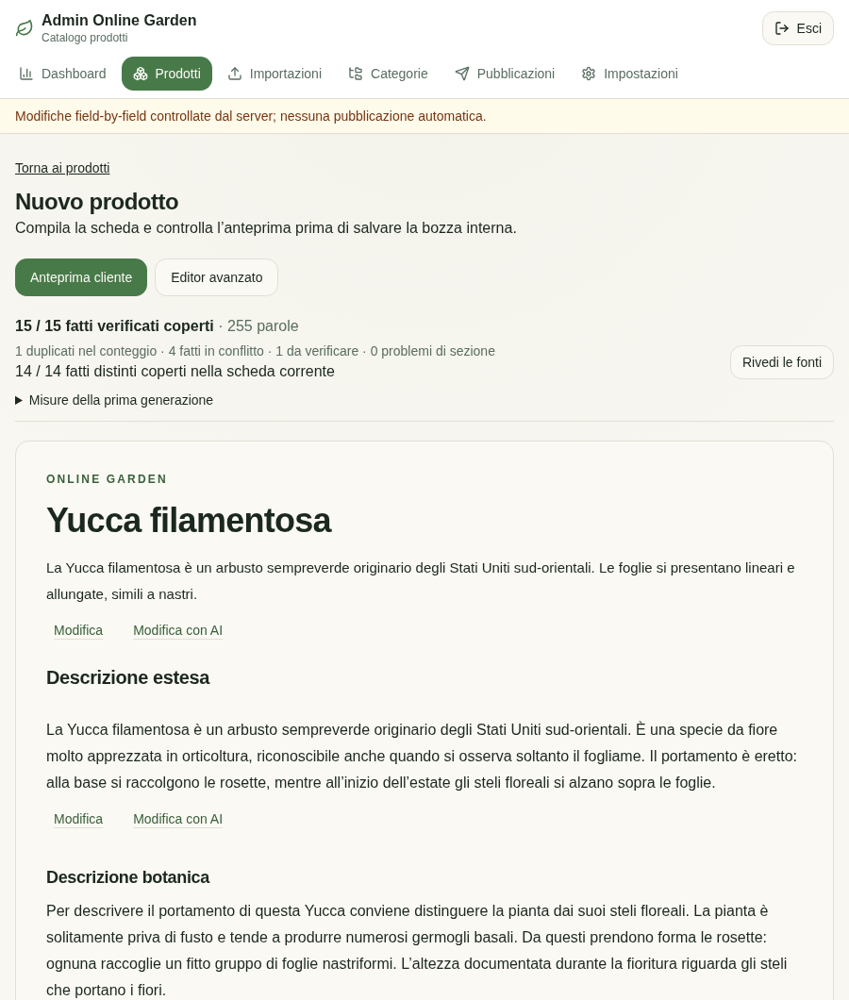
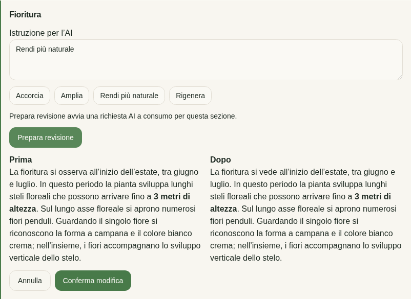

# Online Garden — consegna controllata Admin V2

**Addendum operativo 28/11, mandato finale:** prevale la [consegna finale unica](../CONSEGNA-FINALE-2026-11-28.md). Pubblicazione e checksum degli archivi ricontrollati, V3 iniziale visibile in preview, nessun rilascio. Documentata la procedura History/Publish e il rischio di redeploy Edge con Revert generale: gate rollback ancora non attestato. Preparata l'aggiunta nominativa minima Curiosità, non applicata; autorizzazione della singola DRAFT sempre distinta. Il documento sotto resta ricevuta delle verifiche precedenti, non nuovo test eseguito.

28 novembre 2026. **Decisione unica: NO-GO al rilascio attuale. PENDING_CLIENT_ACCEPTANCE · SAL 57,75%.**

Il candidato integrato è verificato in isolamento; manca l'identificazione ripristinabile delle revisioni effettivamente attive. Non confondere un archivio Git ricostruito con un export del runtime. Nessuna modifica applicativa, Publish, merge, deploy, migration, grant, salvataggio reale o operazione Shopify in questa verifica. Gemini 3 Flash Preview mantenuto; nessun A/B né chiamata AI reale.

## 1. Identità controllate prima del collaudo

- Repository: `Rosin355/your-e-commerce-blueprint`, PR #83.
- Branch effettivo: `codex/ai-product-editor-v3-20261127`.
- Commit applicativo osservato, checkout iniziale pulito: **`14cd12a82192e54156815100ce7e5689e03a8654`**, esattamente quello richiesto. I successivi aggiornamenti sono soltanto documentali.
- Preview: https://id-preview--95cad199-55fd-4870-9d5c-a2653edf88f5.lovable.app/admin/products/new

| Ambito attualmente pubblico | Identità ottenuta | Limite preciso |
|---|---|---|
| Frontend | `published_at=2026-11-26T17:09:40.296219Z`; asset `index-kMoBF-yp.js`, SHA-256 `5f56ebc6dba0610359a64dfa936fc4744419e796d45687728d113fd6dcd4c05d`; CSS `index-jst0clO4.css`, SHA-256 `20e6fa8033d9c163e78c330641c33c4e7a36085c1b14147ea26b4cc0de42878d` | Identici su dominio principale e dominio pubblicato Lovable. Il verbale associa i sorgenti a `d25292501a0d65aff5f28a6820f487836683bb78`; lo strumento attuale non restituisce commit/deployment ID. |
| `product-admin-api` | Ultimo rilascio documentato: `f32989def1fc4d3593744d60c83836a46f247329`, 26/11 circa 15:45 UTC, ricevuta sorgenti/settings `04c778bd3ab3c9a847fe971c68e0e2770397b947258c426fae3e1a34d39692cd`. Lettura autenticata oggi: `backendVersion=admin-editor-20261125`, supporto breve e sheet evidence; **nessun `supportsManualDraftCuriosity`** | Marker coerenti con baseline, non un'identificazione univoca del runtime. Versione attiva, timestamp, pacchetto e `verify_jwt` live non esportati. |
| `product-admin-ai` | Ultimo deploy documentato: **`874f2d398bdb4c635955243ac2a3e1fc5546a254`**, 27/11 18:33 UTC; manifest dei 31 file `d6c02bbce3b9d7365a16278487ac32edfcfbcddadab0b08f196dd54b7e9ccf41`; ricevuta `14af6f9a418c63416d46ee02ab570f85f718ddecef55101a3d37bdc4f27fc332` | Ricevuta precedente verificabile nel repository, non export della revisione attiva oggi. Header e prompt `@3` non distinguono tutti i candidati. Non invocata la funzione per dedurre lo SHA. |

Fonti: [ricevuta AI](../DEPLOY-CORRETTIVO-PRODUCT-ADMIN-AI-V3-874f2d3-2026-11-27.md), [rilascio frontend/API e gate rollback](../ADMIN-V2-RILASCIO-PRODUCT-ADMIN-API-2026-11-26.md). Nessuna nuova versione attiva inventata.

## 2. Artefatti e verifica del rollback

Gli archivi in [artifacts](artifacts/) sono parte della consegna Git, non file temporanei. Ogni manifest contiene inventario e SHA-256 per file. Archivi estratti in una cartella separata e confrontati byte per byte: **PASS**. I quattro pacchetti Edge estratti superano `deno check` con lock congelato. Sono conservate configurazione Git e lock come riferimenti: **non** ripristinare automaticamente configurazione di progetto, JWT o secret.

| Archivio | Contenuto | SHA-256 archivio |
|---|---|---|
| `rollback-api.tar.gz` | Baseline documentata `f32989d`, 40 moduli locali | `abe7d408dd4d05d8a8e7dcffd17f96ad4d32d857e6cb1b93b8d4645d0e3f1c0a` |
| `rollback-ai.tar.gz` | Baseline documentata `874f2d3`, 31 moduli locali; manifest identico a quello del deploy precedente | `cd7b59f8f153f271e2786552383e85e77f77d71137d01b4f3c7c42df895996b3` |
| `candidate-api.tar.gz` | `14cd12a`, 44 moduli locali | `c61c5a6ec9fd99c3a93cdf5e14c26828b64471f105934d1b0d9c6e46e09cdab4` |
| `candidate-ai.tar.gz` | `14cd12a`, 31 moduli locali | `f1aef3780dc1c25f9c465186b8f297f7ede559cc00966f58da38c296617e4061` |
| `frontend-public.tar.gz` | HTML e 37 asset JS/CSS serviti; chunk referenziati inclusi | `e941bbb2756d792dd74dba6d6acde3936200d9912b97a2309a73e2c47dbe58ea` |

Per il frontend non sono esportati configurazione hosting/deployment né un mirror dei media statici: l'archivio dei byte pubblici non certifica da solo la possibilità di caricarlo in Lovable. Per Edge le dipendenze CDN dichiarate sono nel manifest e il lock è conservato; non è un archivio autosufficiente di tutti i pacchetti remoti. **Restore offline dei sorgenti verificato; rollback operativo sul provider non eseguito né attestato.**

Procedura futura: previa autorizzazione, ripristinare soltanto le due revisioni Edge identificate, ciascuna con le proprie dipendenze storiche, e l'artefatto frontend precedente con modalità supportata dal provider. Non combinare entrypoint storici con shared correnti, non usare un restore generale del progetto, non ripristinare DB/Shopify, non cancellare journal. Conservare le chiavi originali delle operazioni incomplete; recuperare la stessa operazione invece di creare nuovamente un prodotto.

## 3. Candidato in preview e percorso senza scritture reali

| Verifica eseguita ora | Risultato |
|---|---|
| Preview con account del richiedente | `/admin/products/new` aperta, ruoli Admin/Editor verificati nella risposta; Anteprima cliente, Editor avanzato e Genera scheda completa visibili. Solo quattro letture API; zero errori pagina e zero comandi di scrittura. Il backend è quello condiviso con la produzione, non il candidato API simulato. |
| Suite Node con rete bloccata | **737 PASS, 0 FAIL** |
| Suite Deno con provider sintetici e senza permesso di rete runtime | **141 PASS, 0 FAIL** |
| Tutte le suite browser esistenti, backend intercettato e traffico esterno bloccato | **46 PASS, 0 FAIL** |
| Packaging/restore | Quattro pacchetti Edge estratti, byte identici e controlli tipi PASS. Build preview osservata: `build OK`. |

Il primo avvio del runner browser non ha potuto avviare la propria versione Chromium: non è un fallimento applicativo. Rieseguite **le stesse suite invariate** con un adattatore temporaneo di lancio verso Chromium già installato: 46 PASS. Nessuna installazione, modifica al candidato o creazione di funzionalità simulate nuove. Log in [evidence](evidence/).

Il test `V3 Yucca su tablet: PDP, modifica isolata, confronto, conferme botaniche e riapertura interna` usa la fixture esistente `scripts/tests/fixtures/yucca-filamentosa-v3.json`. Verifica anteprima cliente completa, modifica manuale del fogliame, errore AI simulato, confronto prima/dopo della fioritura, annullamento e successiva conferma. Conferma individualmente FAQ, caratteristiche, punti di forza e curiosità manuale nella simulazione con grant; poi approva la scheda, verifica che l'applicazione sia ancora soltanto in memoria, salva una sola bozza simulata anche con doppio clic, apre lo stesso prodotto e ricarica la pagina. Asserzioni su descrizione, breve, SEO, tag e tutti i contenuti strutturati salvati. **Zero create Shopify, publish o sync in questo percorso**.

La fixture iniziale completa è documentata a 254 parole; lo screenshot dopo modifica manuale mostra **255 parole, 15/15 fatti nel conteggio storico e 14/14 distinti**, quattro conflitti e una voce da verificare esclusi. Non sono risultati di Gemini. Altri test verificano risposta parziale non approvabile, vecchio contratto `@2` respinto, grant mancante, recovery con la stessa chiave e simulazione della sola create DRAFT senza pubblicazione.

Riproduzione normale nel repository: `npm run test:editor-browser`; prove dominio: `node ci/run-domain.mjs node` e `node ci/run-domain.mjs deno ci/deno-ci.lock`. La fixture non è un caricatore demo nell'anteprima personale: il percorso completo viene attestato dal banco browser già implementato, non da un salvataggio reale con l'account del richiedente.

## 4. Catalogo pubblico e checkout

- Pubblicazione invariata dal 26/11; asset pubblici confrontati sui due domini. Home, `/products` e PDP Rosa Jasmina: HTTP 200, contenuti e prezzo visibili, nessun errore pagina.
- Diff sorgenti dal frontend pubblico documentato: nessuna modifica a `src/lib/shopify.ts`, hook, store, carrello o creazione checkout. Le regressioni storefront verificano `cartCreate`, variante/quantità, URL checkout ed errori con risposte simulate.
- **Il candidato non è solo Admin:** modifica `Pdp.tsx`, `pdpMetafields.ts` e aggiunge `ProductEditorial.tsx` per condividere la resa editoriale e correggere liste JSON/lista/multilinea. Queste modifiche sono coperte dai test browser PDP; non si promette che la resa futura sia byte-identica al frontend pubblico.
- Nessuna nuova sessione checkout reale creata, nessun carrello modificato, ordine o dato personale inserito. Il checkout Shopify reale con riepilogo 200 è evidenza precedente del 28/11, riportata nel verbale integrato, non rieseguita ora perché richiederebbe una mutation Shopify vietata dal mandato.

## 5. Mapping e limiti attuali dei permessi

Registro di produzione riletto in sola lettura. Due grant attivi preservati; **zero grant per `curiosita`**. Il richiedente non ha `tags`, mentre il secondo grant include `tags`. Nessuna modifica ad account, ruoli o capability. Le definizioni Shopify della tabella furono rilette nel verbale integrato del 28/11; non sono state ricertificate mediante una nuova query Shopify in questa sessione. Il candidato impone un nuovo preflight di tipo/owner/accesso al momento dell'eventuale creazione autorizzata.

| Contenuto | Persistenza interna candidata | Destinazione Shopify | Condizione |
|---|---|---|---|
| Descrizione estesa | `description`, HTML sanificato | Core `descriptionHtml` | Revisione e grant; non duplicare su `custom.long_description` |
| Breve | `shortDescription`, distinta, ≤320 caratteri | `custom.short_intro`, multilinea | Supporto backend, mapping e grant |
| SEO titolo/meta | `seoTitle` / `seoDescription` | `seo.title` / `seo.description` | Grant separati e limiti; origine proposta esplicita |
| Tag | `tags` | Core `tags` | Grant esatto; vietati tag logistici, invariati |
| FAQ | `botanical.faq` | `custom.faq_prodotto`, JSON | Conferma specifica; confronto strutturale |
| Caratteristiche | `botanical.key_features` | `custom.key_features`, multilinea corrente | Conferma specifica; codec liste e rilettura |
| Punti di forza | `botanical.key_benefits` | `custom.key_benefits`, multilinea corrente | Solo vantaggi documentati, conferma e grant |
| Curiosità | `botanical.curiosita` solo manuale e con conferma | `custom.curiosita`, multilinea | Implementato nel candidato e collaudato con grant sintetico; **non persistibile autonomamente con i grant reali attuali**; API live non annuncia il supporto |

Le proposte non applicate, confronto temporaneo, fonti e diagnostica AI non sono nuovi campi persistenti. Una curiosità già inclusa nella descrizione segue soltanto quel corpo; non equivale a salvare il metafield dedicato. L'assenza del grant non blocca gli altri campi: non concederlo per aggirare il limite. Se l'accettazione richiede obbligatoriamente tutte le curiosità autonome con l'account Marco, quel singolo criterio resta non collaudabile rispettando il divieto di modificare i permessi; una futura decisione esplicita sul criterio/mandato è necessaria, non un nuovo sviluppo.

## 6. Unica bozza tecnica predisposta, NON creata

[Piano JSON non eseguibile](BOZZA-TECNICA-PIANO.json): SKU `OG-QA-ADMINV2-20261128-14CD12A`, nome `TEST — Yucca filamentosa — NON IN VENDITA`, un formato tecnico, prezzo tecnico proposto 0,00 EUR, nessuna foto o collezione inventata. Stato esclusivamente DRAFT, nessun canale, nessuna attivazione/pubblicazione o modifica inventario. SKU e valori sono proposte tecniche da confermare nella futura autorizzazione, non dati commerciali applicati.

Prima di qualsiasi create: ricerca esatta SKU, approvazione dei testi e dei soli campi abilitati, una chiave idempotente e un solo operation ID. Dopo save/riapertura e create: rilettura degli stessi valori sullo stesso Product/GID. Mismatch o timeout → arresto e riconciliazione della stessa operazione, mai seconda create. Nessun Product/GID inventato o esistente riutilizzato.

## 7. Causa del NO-GO e azione minima

**Impedimento al rilascio tecnico: rollback operativo non attestato.** Gli strumenti accessibili non forniscono revisione attiva/export completo delle due Edge né associazione univoca del frontend pubblicato a un artefatto ripubblicabile. I pacchetti sorgente ricostruiti e il restore offline sono pronti, ma non colmano quella prova.

**Unica azione per superare questo impedimento:** acquisire un'attestazione di rilascio/rollback dal gestore degli artefatti che leghi le tre versioni attive ai pacchetti conservati (ID/versione e timestamp UTC, checksum/inventario, configurazione JWT preservata e procedura supportata di ripristino selettivo). Può confermare la corrispondenza alle baseline archiviate senza concedere accesso a secret o distribuire codice. Nessun nuovo test Gemini, A/B, sviluppo o migration serve a ottenere questa attestazione.

Una volta chiuso il gate e ricevuta **nuova autorizzazione**, le sole operazioni applicative necessarie sono:

1. Integrare la PR #83 sul ramo di rilascio autorizzato e verificare che il contenuto applicativo coincida con `14cd12a`; nessun'altra PR.
2. Distribuire esclusivamente **`product-admin-api` e `product-admin-ai`**, ciascuna con il proprio grafo candidato. Entrambe differiscono dalle baseline documentate: pubblicare solo l'interfaccia non aggiorna metafield, curiosità o validatore semantico. Nessun'altra funzione deve essere distribuita per il solo fatto di condividere moduli.
3. Controllare autenticazione e compatibilità legacy/V3 senza generare contenuti; preservare Gemini 3 Flash Preview, settings, ruoli/grant e flags esistenti. Nessuna migration richiesta dal candidato.
4. Pubblicare il solo frontend integrato dopo esito positivo; verificare gli asset realmente serviti e PDP/catalogo/cart/checkout, tenendo distinte prove simulate e future mutation autorizzate.
5. Solo con mandato separato per i dati: una bozza tecnica DRAFT, save → riapertura → create → read-back; nessuna vendita o pubblicazione prodotto. Un eventuale test reale Gemini richiede budget e consenso propri, non è implicitamente incluso nel Publish.

Non è possibile garantire zero regressioni assolute sulla base di test simulati. Qualità reale Gemini e accettazione personale Marco restano aperte e non sono riclassificate come difetti da sviluppare. **PENDING_CLIENT_ACCEPTANCE · SAL 57,75%.**

## Checklist unica di consegna

- [x] Branch e candidato esatto verificati, nessuna modifica applicativa.
- [x] Frontend pubblico identificato per byte, ultime baseline Edge documentate riconciliate.
- [x] Archivi separati, checksum, restore offline e controlli tipi dei pacchetti.
- [x] Preview autenticata in sola lettura; percorso completo sul banco simulato esistente.
- [x] 737 Node + 141 Deno + 46 browser PASS; zero AI reale e zero scritture reali.
- [x] Mapping, limiti Curiosità/tag e invarianti checkout/catalogo documentati.
- [x] Una sola bozza tecnica pianificata e non creata; modello mantenuto, nessun A/B.
- [ ] Attestazione delle revisioni attive e rollback provider — bloccante tecnico descritto sopra.
- [ ] Autorizzazione futura al rilascio e all'eventuale singola DRAFT — non concessa dal presente mandato.
- [ ] Accettazione personale cliente con i soli campi realmente abilitati — PENDING_CLIENT_ACCEPTANCE.