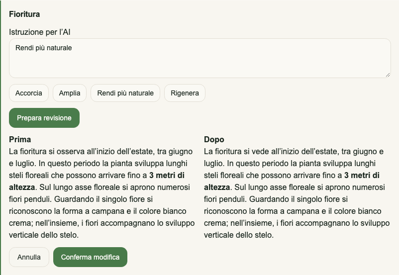

# Admin V2 Product Editor V3 · verbale del 27 novembre 2026

**READY_FOR_UAT nell’ambiente isolato con provider simulato. PENDING_CLIENT_ACCEPTANCE · SAL 57,75%.**

La base è la head della Draft #80, `bcb431e`. Il suo genitore `da55301` contiene l’editor V2. Il commit successivo registra la distribuzione selettiva di `product-admin-ai` con il prompt `online-garden-editoriale-it@2` e la prova reale precedente. La V3 richiede il contratto `online-garden-editoriale-it@3`, presente nel candidato sorgente. La vecchia UI conserva il percorso V2. [Verbale del test reale V2](../ADMIN-V2-DEPLOY-PRODUCT-ADMIN-AI-2026-11-27.md)

## Anteprima e percorso

Inserire il nome, incollare il testo, controllare la fonte e scegliere **Genera scheda completa con AI**. Un input WooCommerce JSON mostra i testi editoriali riconosciuti prima della conferma. Il modello riceve le affermazioni ammissibili con il loro indice di riga. Le affermazioni escluse restano consultabili nel registro.

La modalità **Anteprima cliente** riusa titolo, introduzione, contenitore della descrizione, elenchi, curiosità e fisarmonica FAQ della PDP e il formato valuta dello storefront. I controlli editoriali e i sottotitoli contestuali appartengono all’Admin. La galleria interna mostra le fotografie della bozza in una vista semplificata. La PDP pubblica utilizza la descrizione testuale Shopify. Il riepilogo della bozza conserva l’HTML ammesso, compresi liste e grassetto. Disponibilità, acquisto, pagamento, zoom pubblico e prodotti correlati richiedono il catalogo pubblico.

**Modifica** apre il testo della sezione. **Modifica con AI** apre una richiesta mirata con istruzione libera e azioni rapide. Il confronto permette di confermare o annullare. Una richiesta in corso può essere abbandonata nell’interfaccia. Il provider può avere già ricevuto la richiesta. Le sezioni adiacenti e le modifiche manuali conservano il loro valore. Un cambio della scheda o dei permessi rende obsoleta la proposta.

## Contratto, origine e persistenza

| Contenuto | Generazione, verifica e destinazione |
|---|---|
| Descrizione estesa | Sezioni con titolo ammesso, testo e indici delle fonti. Il validatore controlla quantità, organo, negazioni, formato e riscontri. La bozza salva la descrizione sanificata dopo revisione. |
| Breve | Sintesi distinta composta da frasi intere della presentazione e, se disponibile, di un tratto documentato. Massimo 320 caratteri. Salvataggio subordinato a supporto per descrizioni distinte e grant. |
| SEO e tag | Scelte fra candidati ammessi dal registro. La meta può usare la prima frase dell’introduzione validata. Una revisione mirata richiede la prenotazione positiva per la chiave esatta. Il fallback deterministico rimane identificato. |
| Caratteristiche e punti di forza | Elenchi derivati dai paragrafi verificati, dagli impieghi attestati o da vantaggi espliciti. Il salvataggio richiede supporto del backend, definizione editabile e conferma individuale. |
| FAQ | Coppie domanda e risposta tratte dalle FAQ confermate o da sezioni pertinenti. La bozza può salvare il JSON canonico dopo la conferma specifica. La policy corrente riserva la revisione AI diretta ad altri campi. |
| Curiosità | Estratto documentato in anteprima, modificabile a mano. La bozza nuova non dispone di una destinazione autonoma per questo metafield. Il dettaglio già presente nella descrizione resta nel testo approvato. |
| Cura e botanica | Le indicazioni documentate entrano nella sezione di coltivazione della descrizione. Nomi e dati botanici strutturati preesistenti si mostrano dopo la rispettiva conferma. La modalità avanzata gestisce ogni valore e i periodi. |
| Categorie | Corrispondenza fra testo verificato e titoli delle collezioni effettivamente restituite da `list_editorial_collections`. Per applicare l’ID occorre selezionare la proposta. |
| Foto e dati commerciali | La vista usa foto, formati espliciti e prezzi inseriti. La bozza nuova non fornisce disponibilità live. Un prezzo mancante guida al campo tecnico obbligatorio. |

L’audit storico degli otto export WooCommerce identifica descrizione e breve descrizione. Non rileva colonne ACF esplicite né i campi manuali protetti. Il candidato accetta testo, HTML editoriale ripulito o un prodotto JSON con i campi editoriali riconosciuti, anche in `acf` o `meta_data`. SKU, prezzi e quantità non vengono importati dal JSON. Per un prodotto esistente la modalità avanzata può proporre una baseline collegata al suo snapshot, con origine storica da verificare. [Audit degli export](../../wordpress-import-audit.md)

L’azione esistente `suggest_confirmed_field` accetta il marcatore V3 facoltativo e il contratto tipizzato di revisione. La prenotazione considera campo, fatti, istruzione e versione precedente. La selezione SEO usa la prenotazione batch esistente. La revisione di una sezione della descrizione usa la prenotazione per la sola descrizione. Il testo corrente e la richiesta libera guidano lo stile. Solo i fatti confermati costituiscono prove. Il ruolo catalogo operativo e i grant individuali restano quelli della base. La suite verifica Editor e Admin con ruolo Editor abilitato, oltre al rifiuto per Admin privo di tale ruolo e per grant mancante.

**Rivedi scheda completa** mostra valori, origine, conflitti, mancanze e limiti di mapping. L’operatore conferma individualmente gli eventuali campi strutturati da includere e autorizza una sostituzione dei valori già presenti. **Approva scheda e applica alla bozza** modifica il modulo in memoria. **Salva bozza interna** verifica i codici, i campi e l’approvazione operativa, quindi salva con la chiave idempotente. Eventuali avvisi del server richiedono un ulteriore controllo. La riapertura mostra il contenuto persistito. L’anteprima AI non applicata, gli indici delle fonti e il confronto temporaneo appartengono alla sessione di revisione. Il candidato non introduce una migrazione per archiviare il registro AI.

## Prove ed evidenze

| Prova | Esito |
|---|---|
| Test di dominio Node in modalità offline | 713 PASS |
| Test di dominio Deno, lock congelato e rete runtime disabilitata | 132 PASS |
| Browser Chromium su percorsi Admin e PDP | 39 PASS, dei quali 4 specifici V3 |
| TypeScript frontend, Deno entrypoint AI, lint del perimetro e build Vite | PASS |
| Yucca originale, provider chiuso, risposta professionale preparata per la fixture | 254 parole prima dell’intervento manuale. 15 fatti utilizzabili su 15 coperti, quattro fatti in conflitto e uno ambiguo esclusi. |
| Risposta parziale simulata | Oltre dieci informazioni da recuperare nel caso con sola fioritura. Approvazione bloccata. Recupero della sola introduzione. |
| Revisione, errore e annullamento | Confronto mirato sulla fioritura. La modifica manuale del fogliame resta leggibile dopo riapertura. |
| Persistenza simulata con doppio clic | Una sola bozza interna, FAQ confermate, campo strutturato non selezionato escluso. Zero creazioni Shopify e zero pubblicazioni. |
| Qualità del modello reale V3 e UAT cliente | Da verificare. Le 254 parole appartengono alla fixture, non a una chiamata a consumo. |

Il confronto automatico della copertura è lessicale, con equivalenze e controlli su proprietà sensibili. Un sinonimo valido può richiedere una verifica editoriale e una frase semanticamente impropria può superare i controlli. I cinque fatti esclusi della Yucca restano all’operatore. Lo stelo floreale può arrivare a 3 m. L’altezza della pianta e l’attribuzione della famiglia richiedono fonti concordanti.

Per riprodurre le prove in un checkout con dipendenze installate usare `node ci/run-domain.mjs node`, `node ci/run-domain.mjs deno ci/deno-ci.lock`, `npm run test:editor-browser`, `npx tsc -p tsconfig.app.json --noEmit` e `npm run build`. Playwright avvia localhost e intercetta gli endpoint. Le immagini del verbale provengono dall’app renderizzata durante questa esecuzione.

## Dipendenze e decisione di rilascio

La V3 si confronta con il ramo della #80. La #80 si confronta con il ramo della #79. La #78 riguarda i metafield e segue il proprio percorso di certificazione. I controlli della #78 restano necessari per qualsiasi futura attestazione di sincronizzazione. Il test reale precedente riguarda esclusivamente `@2`. Per accettare `@3` occorrono UAT cliente e una verifica con provider reale in ambiente autorizzato. Questa consegna comprende codice, prove e documentazione. Deploy delle funzioni, Publish del frontend e operazioni su dati reali richiedono decisioni distinte.

## Riscontro UAT visivo e contenuti reali · 27 novembre 2026

**Stato: NON APPROVATO sul piano editoriale.** Screenshot condivisi dal responsabile dalla preview V3 dopo il deploy selettivo della funzione AI. Da queste sole immagini non è possibile attestare `promptVersion`, numero di invocazioni Gemini o pacchetto runtime effettivo; occorre il registro tecnico per tali prove.

- Indicatore V3 mostrato: **5/15 fatti utilizzabili coperti, 137 parole, 4 fatti in conflitto, 1 da verificare, 4 problemi di sezione**; il pannello diagnostico segnala **10 fatti non coperti**, introduzione assente e **3 sezioni da rivedere**. Non confondere i fatti esclusi per conflitto con quelli copribili.
- Sezioni visibili: fogliame, fioritura e portamento. La descrizione è insufficiente rispetto all'obiettivo di una scheda ricca da 250–450 parole **quando le fonti lo consentono**. Mancano introduzione e coltivazione, malgrado la fonte riporti terreno fertile e ben drenato.
- **Controllare i falsi negativi di copertura:** il testo generato menziona fiori bianco crema campanulati su steli e steli floreali fino a 3 m, mentre le frasi sorgenti equivalenti compaiono fra i fatti da recuperare. Analizzare normalizzazione/equivalenze e indici di provenienza; non allentare i controlli su negazioni, organi e quantità. Deduplicare frasi sorgenti equivalenti (es. arbusto sempreverde) e avvisi di sezione ripetuti.
- SEO visualizzata: titolo `Yucca filamentosa`, meta description `Arbusto sempreverde`, tag solo `Yucca filamentosa`, nessuna collezione verificata. Sono valori minimi, non SEO editoriale approvabile. Verificare autorizzazioni/prenotazione, candidati consentiti, output del modello e fallback, senza inventare categorie o claim.
- FAQ e curiosità sono visibili in anteprima. L'AI diretta sulle FAQ è limitata dalla policy corrente, e la curiosità non ha mapping persistibile autonomo. L'approvazione richiede differenziare chiaramente *anteprima*, *applicazione al modulo* e *salvataggio/Shopify*.
- **Criterio UX richiesto dal titolare:** "Da recuperare prima dell'approvazione" deve essere un riepilogo breve e comprensibile, con eventuale recupero semiautomatico già nella generazione entro il limite massimo di chiamate autorizzate; restano manuali solo le vere ambiguità, contraddizioni e fatti non attestati. Evitare una sequenza di dieci click e non far eseguire generazioni aggiuntive nascoste.

**Prossima azione:** aprire un fix sulla PR V3 con fixture di regressione basata su output osservato, copertura e SEO, più UAT visivo, senza nuovi deploy, Publish, scritture prodotto o ulteriori invocazioni AI prima di autorizzazione. Restano `PENDING_CLIENT_ACCEPTANCE` e SAL ufficiale **57,75%**.
