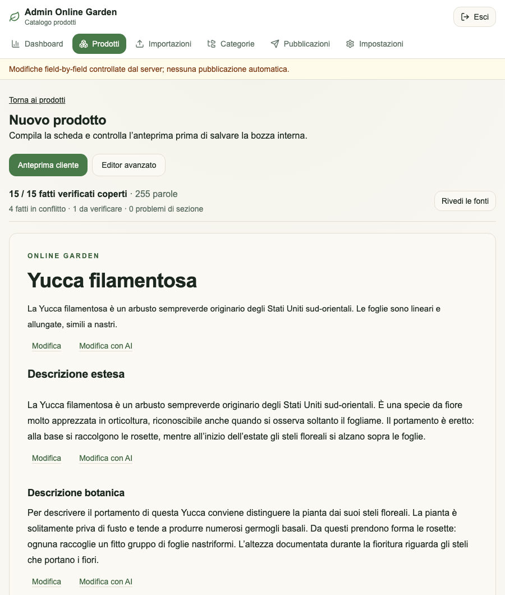

# Admin V2 Product Editor V3 · verbale del 27 novembre 2026

**READY_FOR_UAT nell’ambiente isolato con provider simulato. PENDING_CLIENT_ACCEPTANCE · SAL 57,75%.**

La base è la head della Draft #80, `bcb431e`. Il suo genitore `da55301` contiene l’editor V2. Il commit successivo registra la distribuzione selettiva di `product-admin-ai` con il prompt `online-garden-editoriale-it@2` e la prova reale precedente. La V3 richiede il contratto `online-garden-editoriale-it@3`, presente nel candidato sorgente. La vecchia UI conserva il percorso V2. [Verbale del test reale V2](../ADMIN-V2-DEPLOY-PRODUCT-ADMIN-AI-2026-11-27.md)

## Anteprima e percorso

Inserire il nome, incollare il testo, controllare la fonte e scegliere **Genera scheda completa con AI**. Un input WooCommerce JSON mostra i testi editoriali riconosciuti prima della conferma. Il modello riceve le affermazioni ammissibili con il loro indice di riga. Le affermazioni escluse restano consultabili nel registro.

La modalità **Anteprima cliente** riusa titolo, introduzione, contenitore della descrizione, elenchi, curiosità e fisarmonica FAQ della PDP e il formato valuta dello storefront. I controlli editoriali e i sottotitoli contestuali appartengono all’Admin. La galleria interna mostra le fotografie della bozza in una vista semplificata. La PDP pubblica utilizza la descrizione testuale Shopify. Il riepilogo della bozza conserva l’HTML ammesso, compresi liste e grassetto. Disponibilità, acquisto, pagamento, zoom pubblico e prodotti correlati richiedono il catalogo pubblico.

**Modifica** apre il testo della sezione. **Modifica con AI** apre una richiesta mirata con istruzione libera e azioni rapide. Il confronto permette di confermare o annullare. Una richiesta in corso può essere abbandonata nell’interfaccia. Il provider può avere già ricevuto la richiesta. Le sezioni adiacenti e le modifiche manuali conservano il loro valore. Un cambio della scheda o dei permessi rende obsoleta la proposta.

## Contratto, origine e persistenza

| Contenuto | Generazione, verifica e destinazione |
|---|---|
| Descrizione estesa | Sezioni con titolo ammesso, testo e indici delle fonti. Il validatore controlla quantità, organo, negazioni, formato e riscontri. La bozza salva la descrizione sanificata dopo revisione. |
| Breve | Sintesi distinta composta da frasi intere della presentazione e, se disponibile, di un tratto documentato. Massimo 320 caratteri. Salvataggio subordinato a supporto per descrizioni distinte e grant. |
| SEO e tag | Scelte fra candidati ammessi dal registro. La meta può usare la prima frase dell’introduzione validata. Una revisione mirata richiede la prenotazione positiva per la chiave esatta. Il fallback deterministico rimane identificato. |
| Caratteristiche e punti di forza | Elenchi derivati dai paragrafi verificati, dagli impieghi attestati o da vantaggi espliciti. Il salvataggio richiede supporto del backend, definizione editabile e conferma individuale. |
| FAQ | Coppie domanda e risposta tratte dalle FAQ confermate o da sezioni pertinenti. La bozza può salvare il JSON canonico dopo la conferma specifica. La policy corrente riserva la revisione AI diretta ad altri campi. |
| Curiosità | Estratto documentato in anteprima, modificabile a mano. La bozza nuova non dispone di una destinazione autonoma per questo metafield. Il dettaglio già presente nella descrizione resta nel testo approvato. |
| Cura e botanica | Le indicazioni documentate entrano nella sezione di coltivazione della descrizione. Nomi e dati botanici strutturati preesistenti si mostrano dopo la rispettiva conferma. La modalità avanzata gestisce ogni valore e i periodi. |
| Categorie | Corrispondenza fra testo verificato e titoli delle collezioni effettivamente restituite da `list_editorial_collections`. Per applicare l’ID occorre selezionare la proposta. |
| Foto e dati commerciali | La vista usa foto, formati espliciti e prezzi inseriti. La bozza nuova non fornisce disponibilità live. Un prezzo mancante guida al campo tecnico obbligatorio. |

L’audit storico degli otto export WooCommerce identifica descrizione e breve descrizione. Non rileva colonne ACF esplicite né i campi manuali protetti. Il candidato accetta testo, HTML editoriale ripulito o un prodotto JSON con i campi editoriali riconosciuti, anche in `acf` o `meta_data`. SKU, prezzi e quantità non vengono importati dal JSON. Per un prodotto esistente la modalità avanzata può proporre una baseline collegata al suo snapshot, con origine storica da verificare. [Audit degli export](../../wordpress-import-audit.md)

L’azione esistente `suggest_confirmed_field` accetta il marcatore V3 facoltativo e il contratto tipizzato di revisione. La prenotazione considera campo, fatti, istruzione e versione precedente. La selezione SEO usa la prenotazione batch esistente. La revisione di una sezione della descrizione usa la prenotazione per la sola descrizione. Il testo corrente e la richiesta libera guidano lo stile. Solo i fatti confermati costituiscono prove. Il ruolo catalogo operativo e i grant individuali restano quelli della base. La suite verifica Editor e Admin con ruolo Editor abilitato, oltre al rifiuto per Admin privo di tale ruolo e per grant mancante.

**Rivedi scheda completa** mostra valori, origine, conflitti, mancanze e limiti di mapping. L’operatore conferma individualmente gli eventuali campi strutturati da includere e autorizza una sostituzione dei valori già presenti. **Approva scheda e applica alla bozza** modifica il modulo in memoria. **Salva bozza interna** verifica i codici, i campi e l’approvazione operativa, quindi salva con la chiave idempotente. Eventuali avvisi del server richiedono un ulteriore controllo. La riapertura mostra il contenuto persistito. L’anteprima AI non applicata, gli indici delle fonti e il confronto temporaneo appartengono alla sessione di revisione. Il candidato non introduce una migrazione per archiviare il registro AI.

## Prove ed evidenze

| Prova | Esito |
|---|---|
| Test di dominio Node in modalità offline | 713 PASS |
| Test di dominio Deno, lock congelato e rete runtime disabilitata | 132 PASS |
| Browser Chromium su percorsi Admin e PDP | 39 PASS, dei quali 4 specifici V3 |
| TypeScript frontend, Deno entrypoint AI, lint del perimetro e build Vite | PASS |
| Yucca originale, provider chiuso, risposta professionale preparata per la fixture | 254 parole prima dell’intervento manuale. 15 fatti utilizzabili su 15 coperti, quattro fatti in conflitto e uno ambiguo esclusi. |
| Risposta parziale simulata | Oltre dieci informazioni da recuperare nel caso con sola fioritura. Approvazione bloccata. Recupero della sola introduzione. |
| Revisione, errore e annullamento | Confronto mirato sulla fioritura. La modifica manuale del fogliame resta leggibile dopo riapertura. |
| Persistenza simulata con doppio clic | Una sola bozza interna, FAQ confermate, campo strutturato non selezionato escluso. Zero creazioni Shopify e zero pubblicazioni. |
| Qualità del modello reale V3 e UAT cliente | Da verificare. Le 254 parole appartengono alla fixture, non a una chiamata a consumo. |

Il confronto automatico della copertura è lessicale, con equivalenze e controlli su proprietà sensibili. Un sinonimo valido può richiedere una verifica editoriale e una frase semanticamente impropria può superare i controlli. I cinque fatti esclusi della Yucca restano all’operatore. Lo stelo floreale può arrivare a 3 m. L’altezza della pianta e l’attribuzione della famiglia richiedono fonti concordanti.

Per riprodurre le prove in un checkout con dipendenze installate usare `node ci/run-domain.mjs node`, `node ci/run-domain.mjs deno ci/deno-ci.lock`, `npm run test:editor-browser`, `npx tsc -p tsconfig.app.json --noEmit` e `npm run build`. Playwright avvia localhost e intercetta gli endpoint. Le immagini del verbale provengono dall’app renderizzata durante questa esecuzione.

## Dipendenze e decisione di rilascio

La V3 si confronta con il ramo della #80. La #80 si confronta con il ramo della #79. La #78 riguarda i metafield e segue il proprio percorso di certificazione. I controlli della #78 restano necessari per qualsiasi futura attestazione di sincronizzazione. Il test reale precedente riguarda esclusivamente `@2`. Per accettare `@3` occorrono UAT cliente e una verifica con provider reale in ambiente autorizzato. Questa consegna comprende codice, prove e documentazione. Deploy delle funzioni, Publish del frontend e operazioni su dati reali richiedono decisioni distinte.

## Riscontro UAT visivo e contenuti reali · 27 novembre 2026

**Stato: NON APPROVATO sul piano editoriale.** Screenshot condivisi dal responsabile dalla preview V3 dopo il deploy selettivo della funzione AI. Da queste sole immagini non è possibile attestare `promptVersion`, numero di invocazioni Gemini o pacchetto runtime effettivo; occorre il registro tecnico per tali prove.

- Indicatore V3 mostrato: **5/15 fatti utilizzabili coperti, 137 parole, 4 fatti in conflitto, 1 da verificare, 4 problemi di sezione**; il pannello diagnostico segnala **10 fatti non coperti**, introduzione assente e **3 sezioni da rivedere**. Non confondere i fatti esclusi per conflitto con quelli copribili.
- Sezioni visibili: fogliame, fioritura e portamento. La descrizione è insufficiente rispetto all'obiettivo di una scheda ricca da 250–450 parole **quando le fonti lo consentono**. Mancano introduzione e coltivazione, malgrado la fonte riporti terreno fertile e ben drenato.
- **Controllare i falsi negativi di copertura:** il testo generato menziona fiori bianco crema campanulati su steli e steli floreali fino a 3 m, mentre le frasi sorgenti equivalenti compaiono fra i fatti da recuperare. Analizzare normalizzazione/equivalenze e indici di provenienza; non allentare i controlli su negazioni, organi e quantità. Deduplicare frasi sorgenti equivalenti (es. arbusto sempreverde) e avvisi di sezione ripetuti.
- SEO visualizzata: titolo `Yucca filamentosa`, meta description `Arbusto sempreverde`, tag solo `Yucca filamentosa`, nessuna collezione verificata. Sono valori minimi, non SEO editoriale approvabile. Verificare autorizzazioni/prenotazione, candidati consentiti, output del modello e fallback, senza inventare categorie o claim.
- FAQ e curiosità sono visibili in anteprima. L'AI diretta sulle FAQ è limitata dalla policy corrente, e la curiosità non ha mapping persistibile autonomo. L'approvazione richiede differenziare chiaramente *anteprima*, *applicazione al modulo* e *salvataggio/Shopify*.
- **Criterio UX richiesto dal titolare:** "Da recuperare prima dell'approvazione" deve essere un riepilogo breve e comprensibile, con eventuale recupero semiautomatico già nella generazione entro il limite massimo di chiamate autorizzate; restano manuali solo le vere ambiguità, contraddizioni e fatti non attestati. Evitare una sequenza di dieci click e non far eseguire generazioni aggiuntive nascoste.

**Prossima azione:** aprire un fix sulla PR V3 con fixture di regressione basata su output osservato, copertura e SEO, più UAT visivo, senza nuovi deploy, Publish, scritture prodotto o ulteriori invocazioni AI prima di autorizzazione. Restano `PENDING_CLIENT_ACCEPTANCE` e SAL ufficiale **57,75%**.

## Correzione post-UAT · candidata al retest

Il riferimento live è il verbale del commit `8a759b0`. Le schermate documentano tre sezioni visibili, 137 parole e dieci omissioni segnalate. Il verbale del deploy registra separatamente un tentativo autenticato rifiutato prima del modello. Mancano gli argomenti grezzi restituiti dal provider e l'esito per singola sezione della sessione mostrata nelle schermate. Non sono ricostruibili retroattivamente il motivo di ciascuno scarto, i grant effettivi della sessione o le sue prenotazioni SEO.

### Risultati misurati

| Prova | Parole | Fatti coperti sui 15 utilizzabili | Esito |
|---|---:|---:|---|
| UAT riportata dal responsabile | 137 | 5 | Tre sezioni visibili; approvazione editoriale respinta |
| Ricostruzione delle tre sezioni sul codice precedente | 137 | 5 | Baseline riprodotta |
| Identico testo con il comparatore corretto | 137 | 8 | Riconosciuti fiore campanulato bianco crema, altezza dello stelo floreale e germogli basali |
| Identica risposta simulata dopo integrazione locale | 163 | 10 | Tre sezioni recuperate, cinque informazioni ancora da integrare, approvazione bloccata |
| Stessa scheda completata manualmente nel browser | 292 | 15 | Nessuna richiesta AI oltre a quella iniziale simulata |
| Risposta completa indipendente del provider simulato | 254 | 15 | Percorso iniziale completo in una risposta descrittiva |

La fixture parziale riproduce lunghezza, contatore iniziale, temi e sinonimi osservati. Il testo è una ricostruzione sintetica. Il denominatore di 15 mantiene confrontabilità con la UAT e include due formulazioni dello stesso arbusto sempreverde. La UI identifica il duplicato e lo raggruppa nel recupero. Quattro affermazioni contraddittorie e una ambigua rimangono escluse. Il target di 250–450 parole si applica a fonti sufficientemente ricche; una risposta lacunosa richiede revisione, senza riempitivi per raggiungere il numero.

### Contratto AI e indicazioni developer

- Il provider riceveva atomi con indici condivisi dalla stessa riga e una richiesta generale di completezza. Ora riceve anche la sezione suggerita per ogni atomo nella generazione iniziale. Il prompt specifica come citare la riga originale e come distribuire le affermazioni prima di rispondere. La revisione mirata mantiene l'istruzione per una sola sezione. Budget, versione di trasporto V3 e prenotazioni esistenti restano quelli della #83.
- Il validatore scarta l'intera sezione per formato, fonte insufficiente o copia estrattiva. Per il prossimo retest il riepilogo conserva il numero di sezioni ricevute, accettate, scartate e derivate localmente. Se il provider ha restituito almeno una sezione valida, la prima generazione può colmare tre titoli mancanti da costrutti positivi circoscritti (portamento sempreverde, origine, preferenza di terreno). Le integrazioni sono indicate come derivate dalle fonti; un precedente scarto della stessa sezione resta un avviso da risolvere esplicitamente.
- La copertura lessicale richiedeva tutte le radici, compresi verbi accessori, e trattava in modo differente stelo/asse, produce/produrre e m/metri. La correzione si applica alle sezioni validate con riferimenti pertinenti. Colore e forma devono riferirsi al fiore. Restano i controlli su misura, organo, contesto, frequenza, negazione e famiglia. L'indice di fonte da solo non assegna copertura.
- Nella selezione SEO il modello sceglie indici di candidati già ammessi. La vecchia lista poteva proporre soltanto il titolo prodotto e il primo frammento breve. La #83 filtrava già definizioni, grant e campi restituiti dalla prenotazione batch. Se la RPC batch manca, il percorso legacy può prenotare la sola descrizione. La selezione SEO/tag può essere eseguita soltanto per le chiavi prenotate e idonee; i tag AI richiedono il mapping core previsto. Una proposta deterministica è distinta dalla selezione modello. Nessun retry.
- Con la Yucca, anche senza prenotazione SEO, il test produce **Yucca filamentosa – arbusto sempreverde**, **Yucca filamentosa – arbusto sempreverde. Predilige un terreno fertile e ben drenato.**, tag **Yucca filamentosa** e **arbusto sempreverde**. I candidati ricchi usano fatti positivi e verificati e passano la validazione del registro. I campi indisponibili non vengono applicati. Le collezioni richiedono un ID ammesso dal catalogo e una selezione esplicita.

### Matrice di persistenza

| Campo | Anteprima | Applicazione al modulo | Persistenza Admin simulata | Destinazione Shopify prevista | Pubblicazione / storefront |
|---|---|---|---|---|---|
| Estesa | Sezioni, origine e copertura | HTML sanificato con grant description | description | descriptionHtml | Scheda prodotto del canale |
| Breve | Sintesi distinta | Con supporto e grant short_description | shortDescription | custom.short_intro se definizione compatibile | Introduzione PDP |
| Titolo SEO | Modello o derivato | Con grant seo_title e limite campo | seoTitle | seo.title | Metadati della pagina |
| Meta description | Modello o derivata | Con grant seo_description e limite campo | seoDescription | seo.description | Metadati della pagina; snippet a discrezione del motore |
| Tag | Lista verificabile | Con registro/abilitazione bozze e controllo formato | tags | tags core | Tassonomia; visibilità secondo storefront |
| Caratteristiche principali | Elenco | Se selezionato e confermato, con grant | botanical.key_features | custom.key_features se definito | Blocco PDP condizionale |
| Punti di forza | Solo impieghi o vantaggi documentati | Stessa conferma individuale | botanical.key_benefits | custom.key_benefits se definito | Blocco PDP condizionale |
| FAQ | Coppie domanda/risposta | Con conferma specifica | botanical.faq | Mapping FAQ verificato verso custom.faq_prodotto | Fisarmonica PDP |
| Curiosità | Estratto o modifica manuale | Solo anteprima autonoma | Nessun campo nella nuova bozza | Proposta futura: riusare la chiave di registro curiosita e il metafield custom.curiosita | Il consumer PDP esiste già; il percorso dalla nuova bozza richiede ancora sviluppo |

La prova browser controlla il payload salvato per tutti gli otto campi supportati, la riapertura della bozza e l'assenza di curiosità autonome nel payload. Per rendere persistibili le curiosità occorre estendere allowlist della nuova bozza, conferma individuale, validazione per tipo, proiezione di rilettura e verifica definizione/valore del metafield. I contenuti già presenti nel corpo esteso seguono soltanto quel corpo. Sincronizzazione e pubblicazione richiedono autorizzazioni, mapping e riletture separati; in questo collaudo non è stato contattato Shopify.

### Guida al collaudo cliente e designer

1. Inserire la fonte Yucca verificata, generare una volta e annotare versione, identificativo richiesta, parole e contatori. In **Rivedi scheda completa → Origine e versione** controllare i conteggi delle sezioni prima della revisione. Verificare introduzione, botanica e terreno. Distinguere l'altezza dello stelo dall'altezza della pianta.
2. Nel riepilogo **Alcune informazioni non sono ancora incluse nella descrizione** aprire una sezione. **Integra manualmente** consente di scrivere e indicare le righe utilizzate. **Rivedi con AI** apre il confronto: soltanto **Prepara revisione** invia la richiesta aggiuntiva a consumo. In un collaudo senza budget aggiuntivo usare il percorso manuale. Confermare o annullare prima di passare alla sezione successiva.
3. Controllare che le modifiche aggiornino la copertura e le sintesi derivate; le revisioni manuali autonome vengono preservate. Verificare che le informazioni mancanti e gli scarti irrisolti impediscano l'approvazione. Controllare SEO, limiti dei campi, tag e assenza di collezioni presunte.
4. Nella prova simulata confermare separatamente caratteristiche, punti di forza e FAQ; applicare al modulo, salvare la bozza interna e riaprirla. Le curiosità devono essere segnalate come sola anteprima. Confrontare il valore visibile con il valore persistito prima di chiedere qualunque prova di sincronizzazione o pubblicazione.

Collaudo offline completato con 718 test Node, 132 test Deno e 40 test browser superati. Verificati anche i tipi dell’entrypoint Deno e la build dell’Admin.

**READY_FOR_RETEST** per il candidato offline. Il raggiungimento del target di lunghezza e copertura da parte di Gemini al primo tentativo reale richiede una successiva prova autorizzata. PENDING_CLIENT_ACCEPTANCE · SAL 57,75%.

## Retest reale V3: diagnosi modello vs validatore

**Esito UAT condiviso in screenshot:** 165 parole e 9/15 fatti utilizzabili coperti; un duplicato contato, quattro fatti in conflitto, uno da verificare e quattro problemi di sezione. Sei fatti restano non coperti. Titolo e meta SEO ora risultano piu articolati, ma l'esito editoriale non e approvato.

**Da distinguere (non ancora provato quale sia la causa dominante):**

- Modello: il sorgente usa ADMIN_AI_MODEL se impostato, altrimenti google/gemini-3-flash-preview. Non e documentato il modello effettivo del singolo retest; consultare il registro AI.
- Configurazione: temperatura 0.2, max_tokens 2000 per descrizione, timeout 12s; verificare se finish_reason, usage o timeout abbiano inciso. Non assumere che i limiti siano stati raggiunti.
- Validator: valida e puo scartare la sezione intera se una frase non e supportata, per problemi di formato o copia estrattiva. Acquisire sectionAudit (received/accepted/rejected/derived) e ragioni di ogni scarto, confrontando numero di parole prima e dopo il filtro.
- Le fonti del test contengono contraddizioni su famiglia e altezza della pianta, piu un'espressione ambigua sul fusto. Non risolvere con inferenze automatiche. Valutare le sei omissioni residue come omissione effettiva, equivalenza o risultato di sezione scartata.

**Proposta di decisione:** prima diagnosi in sola lettura della richiesta recente, senza nuove invocazioni AI. Solo dopo, A/B controllato, esplicitamente autorizzato e con costo contingentato, tra modello Google e modello OpenAI effettivamente disponibile nel workspace, usando stesso input, schema e validator. Valutare testo grezzo, sezioni accettate, copertura, stile, SEO, costo e latenza. Cambiare modello senza correggere l'interazione con il validator non garantisce una descrizione migliore.

Nessun deploy, Publish, migrazione, salvataggio prodotto o chiamata AI autorizzati dalla presente nota. PENDING_CLIENT_ACCEPTANCE, SAL 57,75%.

## Diagnosi del retest da 165 parole

**27 novembre 2026 · PENDING_CLIENT_ACCEPTANCE · SAL 57,75%.** Esito editoriale ancora insufficiente. Il verbale delle 19:43 registra il risultato dell'operatore. Il registro AI di Lovable e il log della funzione aggiungono le evidenze seguenti.

| Voce | Evidenza relativa al retest |
|---|---|
| ACTUAL_MODEL | L'ultima attività `chat_completions` del gateway nella finestra del retest riporta `google/gemini-3-flash-preview`, completata con successo. La funzione registra `suggest_confirmed_field`, campo `description`, stadio `model_validated` alle 19:39:20 (ora italiana). L'attribuzione alla Yucca si basa sulla finestra temporale e sul percorso descrittivo. I due registri consultati non espongono una chiave comune che identifichi il prodotto. |
| PROVIDER_LIMITS | Nel pannello dei secret di progetto al momento della diagnosi sono assenti `ADMIN_AI_MODEL` e `ADMIN_AI_TIMEOUT_MS`. Il percorso di produzione usa i default. Temperatura 0,2, timeout 12 s per chiamata, `max_tokens` 2.000 per la descrizione e 256 per l'eventuale selezione SEO. Il limite applicativo della descrizione è di 8.000 caratteri e il suo superamento genera un errore. Il gateway riporta 1.358 token in ingresso, 626 in uscita, 3,6 s e 0,0051 crediti per l'attività osservata. `finish_reason` non disponibile. |
| MODEL_OUTPUT_WORDS | Non verificabile. Il gateway segnala che il contenuto di richiesta e risposta non è stato conservato per questa attività. I token di uscita includono la risposta strutturata e non misurano le parole delle sezioni. |
| VALIDATED_OUTPUT_WORDS | **165** parole nell'anteprima UAT, calcolate sui testi delle sezioni finali. Il totale può comprendere integrazioni locali. |
| SECTION_AUDIT | Ricevute, accettate, scartate e derivate: **quattro valori indisponibili**. Mancano il riepilogo iniziale e la lista dei motivi per titolo. Il dato disponibile è **4 problemi di sezione**, somma di problemi dell'anteprima e avvisi deduplicati. |
| Copertura e SEO | **9/15 (60%)**, sei fatti segnalati scoperti, un duplicato nel denominatore, quattro affermazioni in conflitto e una da verificare escluse. Titolo e meta SEO più articolati secondo UAT. Mancano elementi per classificare singolarmente le sei omissioni o attribuire il miglioramento SEO a una seconda chiamata. |

**ROOT_CAUSES.** Il successo in 3,6 s e i 626 token in uscita non indicano esaurimento del limite di 2.000 o timeout. Nel replay il prompt contiene tutte le 15 affermazioni ammesse. Il validatore può perdere una sezione intera per una frase equivalente e il contatore può segnalare scoperta un'affermazione presente. Una risposta simulata completa passa con 254 parole e 15/15. Rimangono indeterminate nel retest reale la quota già omessa dal modello, quella eliminata dal filtro e quella presente ma non riconosciuta. [Prove sulle parafrasi e regole di conteggio](../../editor-step1/DEVELOPER.md#diagnosi-yucca-del-27-novembre-2026)

**RECOMMENDED_MODEL_TEST.** Pilota proposto fra Gemini 3 Flash Preview e OpenAI GPT-5.4 Mini. Entrambi figurano nel catalogo del workspace. Il protocollo misura la differenza prima e dopo la validazione, la qualità italiana in cieco, la completezza SEO, la latenza e il costo. [Protocollo e criteri](../../editor-step1/DEVELOPER.md#protocollo-ab-proposto) · [Catalogo chat ufficiale](https://docs.lovable.dev/features/ai-chat)

**ESTIMATED_COST_COMPARISON.** Per una singola descrizione di 1.358 token in ingresso e 626 in uscita, a tariffa API standard in USD per milione di token testuali, ingresso senza cache:

| Modello | Ingresso / uscita per milione | Stima teorica a volumi identici |
|---|---:|---:|
| Gemini 3 Flash Preview | 0,50 / 3,00 USD | 0,002557 USD |
| GPT-5.4 Mini | 0,75 / 4,50 USD | 0,0038355 USD (+50%) |

Il calcolo usa i listini dei fornitori. Lovable usa crediti e indica di riferirsi a quei listini per confronti relativi. L'unico consumo misurato è **0,0051 crediti** per la chiamata Gemini. Mancano un consumo osservato di B e una tariffa gateway in crediti per fare una previsione di addebito. [Google](https://ai.google.dev/gemini-api/docs/pricing#gemini-3-flash-preview) · [OpenAI](https://developers.openai.com/api/docs/models/gpt-5.4-mini) · [Criterio di fatturazione Lovable](https://docs.lovable.dev/features/ai#usage-and-pricing)

**NEXT_ACTION.** Recuperare dalla risposta già ricevuta i quattro contatori di `sectionAudit` e, per ciascun elemento di `descriptionIssues`, solo sezione, codice e messaggio. Se la risposta è ancora in anteprima, «Revisione finale → Origine e versione della proposta» mostra i contatori quando il pannello è accessibile. Per le sei omissioni occorrono anche le voci `coverage` scoperte. Se la sessione è chiusa e manca una copia, il numero di parole grezze e l'attribuzione retrospettiva degli scarti restano indisponibili. Alla prossima prova autorizzata, raccogliere le misure pre/post nel banco di prova. Questa diagnosi ha utilizzato registri esistenti e prove offline.

## Decisione del gate post-diagnosi: prima validatore, poi A/B

**Decisione tecnica proposta (27 novembre 2026):** non sostituire il modello in produzione e non avviare subito le 3 coppie di test. La diagnosi osservata e' coerente con Gemini 3 Flash Preview senza saturazione dei limiti (3,6 s; 626/2.000 token), ma non attribuisce il divario di copertura a modello o validator perche' mancano risposta grezza e sectionAudit. Sono riprodotti un falso negativo su portamento eretto/verticale e un falso positivo su fiori penduli/eleganti.

1. **Prima senza nuovo consumo:** se la sessione Admin conserva ancora la risposta, estrarre solo metadati `sectionAudit` (received/accepted/rejected/derived), `descriptionIssues` (section/code/message), `coverage` (status e indici; no contenuti personali), e diagnostica della singola richiesta. Se non disponibile, dichiarare `NOT_RETRIEVABLE` senza nuove chiamate.
2. **Fix offline su PR #83:** regressioni semanticamente conservative su parafrasi corrette, attributi inventati, negazioni, organi e misure; validare le frasi per unita' quando possibile, preservando quelle supportate anziche' scartare un intero paragrafo per un solo claim. Non allentare il blocco di proprieta' botaniche non attestate. Misurare sia copertura automatica che revisione umana su **14 fatti distinti** oltre al denominatore legacy 15.
3. **Strumentazione limitata:** nella futura prova isolata registrare contatori di sezioni, parole pre/post per stadio, reason codes, modello/usage/latency/costo senza salvare payload grezzi o informazioni private nei log di produzione. Se e' necessaria una cattura completa della proposta per debugging, mantenerla in memoria o in un test locale privato con retention breve e accesso ristretto.
4. **Solo dopo:** proporre, con autorizzazione e budget espliciti, un pilota A/B di **una coppia** Gemini 3 Flash Preview vs GPT-5.4 Mini, stesso input, schema, limiti e validator corretto; approvare l'eventuale estensione a tre coppie soltanto se la prima misura e' informativa. Non cambiare `ADMIN_AI_MODEL` o altri settings globali per eseguire il confronto; evitare impatto sull'Admin pubblicato.

**Gate:** nessun deploy, Publish, merge, modifica privilegi, chiamata Gemini/OpenAI reale o scrittura prodotto autorizzati da questa decisione. PENDING_CLIENT_ACCEPTANCE; SAL ufficiale 57,75%.
